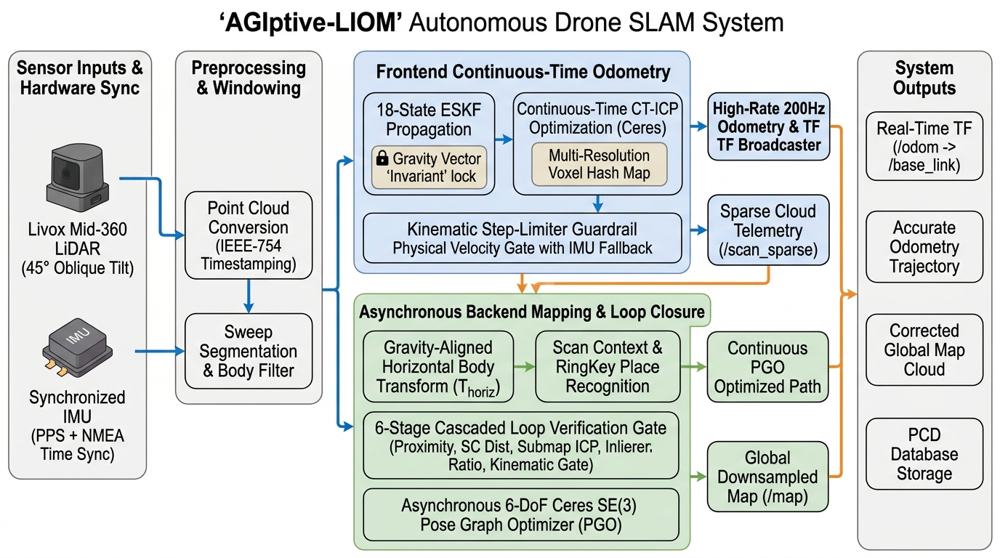

# Agipix Autonomy: Perception
<div align="center">
  <p class="lede-title"><strong>AGIptive-LIOM</strong></p>
  <p class="lede-sub"><strong>Degradation-Resilient Continuous-Time LiDAR-Inertial Odometry and Mapping</strong></p>

  <p>
    <a href="https://sasakuruppuarachchi.github.io/" target='_blank'><strong>Sasanka Kuruppu Arachchige</strong></a><sup>1,*†</sup>
    <a href="https://webpages.tuni.fi/vision/public_pages/JoniKamarainen/" target='_blank'>Joni-Kristian Kämäräinen</a><sup>1</sup>&nbsp;&nbsp;&nbsp;
  </p>
  <p>
    <sup>1</sup>Computer Vision Group, Tampere University, Finland<br>
    <em>(* Principal Developer, † Corresponding Author)</em>
  </p>

  <p>
    <a href="https://github.com/SasaKuruppuarachchi/AGIptive-LIOM"></a>
    <a href="https://github.com/SasaKuruppuarachchi/AGIptive-LIOM"></a>
    <a href="https://github.com/SasaKuruppuarachchi/AGIptive-LIOM"></a>
    <a href="https://github.com/SasaKuruppuarachchi/AGIptive-LIOM"></a>
    <a href="https://github.com/SasaKuruppuarachchi/AGIptive-LIOM"></a>
  </p>
</div>

---
<figure class="two-up">
  
  
  <figcaption>The mapping result of AGIptive-LIOM at Hervanta rock.</figcaption>
</figure>

## 📖 Overview

**AGIptive-LIOM** is an advanced, degradation-resilient Continuous-Time LiDAR-Inertial Odometry and Mapping (LIOM) framework engineered for resource-constrained Unmanned Aerial Vehicles (UAVs) operating in complex, unstructured, and GPS-denied environments (such as dense forest canopies, subterranean caverns, and cluttered industrial facilities).

Conventional aerial LIO systems experience catastrophic divergence in dense foliage due to geometric degeneracy ($$\lambda_1 \approx \lambda_2 \approx \lambda_3$$), unconstrained ESKF gravity drift during double integration, and place recognition failures when solid-state LiDARs are mounted obliquely (e.g., $$45^\circ$$ downward pitch). **AGIptive-LIOM** introduces a complete mathematical and architectural solution:

1. **Gravity-Aligned Local Horizontal Transformation ($$T_{\text{horiz}}$$)**: Restores true $$360^\circ$$ yaw invariance for 2D polar bird's-eye place recognition descriptors under arbitrary sensor tilt.
2. **Degeneracy-Aware Kinematic Prior Fallback**: Physical velocity/acceleration envelopes in continuous-time Ceres optimization prevent single-frame solver divergence jumps in unstructured vegetation.
3. **ESKF Gravity Vector State Invariant**: Anchors the world vertical axis permanently to true physical gravity, eliminating fictitious acceleration integration and vertical drift.
4. **6-Stage Cascaded Loop Verification Gate & Asynchronous SE(3) Ceres PGO**: High-precision place recognition with submap Point-to-Plane ICP and background 6-DoF graph optimization.

---

## 🏗️ System Architecture

<figure>
  
  <figcaption>Figure 1: Complete pipeline architecture of AGIptive-LIOM showing sensor synchronization, frontend continuous-time odometry, and asynchronous backend mapping &amp; pose graph optimization.</figcaption>
</figure>

The system operates across three decoupled, high-performance pipelines:
- **Data Ingestion & Hardware Time Sync**: Synchronizes Livox Mid-360 LiDAR point clouds and high-rate IMU telemetry over microsecond-accurate hardware clocks.
- **Frontend Continuous-Time LIO (200 Hz)**: Evaluates point-to-plane residuals along continuous trajectory splines with multi-resolution hash maps (`MultipleResolutionVoxelMap` via `tsl::robin_map`), protected by the kinematic step-limiter guardrail.
- **Asynchronous Backend Mapping & Loop Closure (Background Worker)**: Extracts gravity-leveled Scan Context descriptors, validates loop closures through 6 cascaded gates, and solves 6-DoF Ceres SE(3) pose graphs without interrupting real-time flight control odometry.

---

## 🔬 Core Innovations & Mathematical Formulations

### 1. Gravity-Aligned Local Horizontal Coordinate Frame ($$T_{\text{horiz}}$$)
When a LiDAR is mounted at a $$45^\circ$$ downward pitch, projecting point clouds into the sensor frame destroys polar descriptor consistency across changing heading angles. AGIptive-LIOM levels descriptors into a gravity-aligned horizontal frame:

1. Extract the current world pose $$T_{W} = \begin{bmatrix} R_{W} & \mathbf{t}_{W} \\ \mathbf{0}^T & 1 \end{bmatrix}$$ and horizontal yaw angle $$\psi = \text{atan2}(R_{W(1,0)}, R_{W(0,0)})$$.
2. Construct the horizontal body frame:
   $$T_{\text{horiz}} = \begin{bmatrix} \text{RotZ}(\psi) & \mathbf{t}_{W} \\ \mathbf{0}^T & 1 \end{bmatrix}$$
3. Transform point clouds prior to Scan Context extraction:
   $$P_{\text{horiz}} = T_{\text{horiz}}^{-1} \cdot P_{\text{world}} = \text{RotZ}(\psi)^T (P_{\text{world}} - \mathbf{t}_{W})$$
4. Elevation $$Z_{\text{horiz}}$$ is strictly parallel to true gravity, restoring exact rotation invariance across $$360^\circ$$ loops regardless of sensor tilt.

```
       Oblique Body Frame (45° Tilt)           Gravity-Aligned Frame (T_horiz)
             ▲ z_lidar                                    ▲ z_world (Gravity)
             │   /                                        │
             │  /                                         │   ▲ x_horiz (Forward)
             │ / 45°                                      │  /
             └──────► x_lidar                             └─/────► y_horiz (Left)
     [Distorted Polar Slices]                     [True Level BEV Polar Slices]
```

### 2. Degeneracy-Aware Kinematic Prior Fallback
In unstructured foliage and open skies, point normal distributions lack geometric planar structure ($$\lambda_1 \approx \lambda_2 \approx \lambda_3$$), causing the Ceres CT-ICP Hessian matrix to become ill-conditioned. AGIptive-LIOM enforces a physical motion guardrail:
- If the iterative optimization step violates the physical envelope:
  $$\|\mathbf{t}_{\text{opt}} - \mathbf{t}_{\text{prior}}\| > 1.2\text{ m} \quad (\approx 12\text{ m/s}) \quad \text{or} \quad \Delta \theta > 25^\circ$$
- The solver step is rejected, and the system automatically falls back to the continuous IMU state propagation prior, guaranteeing zero catastrophic divergence jumps.

### 3. ESKF Gravity Vector State Invariant
Updating the 3D gravity error state via unconstrained LiDAR residuals in vegetation introduces fictitious tilt, triggering quadratic vertical velocity divergence. AGIptive-LIOM fixes the world vertical axis to physical gravity:
- Sets `options_.update_gravity_ = false` and initial gravity covariance $$\Sigma_g = \mathbf{0}_{3 \times 3}$$.
- Keeps $$\mathbf{g}_{\text{world}} = [0, 0, -9.805]^T\text{ m/s}^2$$ locked, eliminating altitude runaway during long flights.

### 4. 6-Stage Cascaded Loop Verification Gate
To eliminate false loop closures in repetitive tree trunks and canopy foliage:
- **Gate 1 (Proximity)**: KD-Tree search radius $$\le 15.0\text{ m}$$, keyframe interval $$\ge 25$$ frames.
- **Gate 2 (Descriptor Distance)**: Scan Context cosine distance $$D_{SC} \le 0.28$$.
- **Gate 3 (Submap ICP)**: 9-keyframe target submap Point-to-Plane ICP alignment ($$RMS \le 0.30\text{ m}$$).
- **Gate 4 (Inlier Ratio)**: Minimum $$60\%$$ inlier overlap ratio with nearest neighbor threshold $$\le 0.25\text{ m}$$.
- **Gate 5 (Kinematic Deviation)**: Odometry consistency bound ($$\Vert \Delta \mathbf{t}\Vert  \le 0.8\text{ m}, \vert \Delta z\vert  \le 0.40\text{ m}, \vert \Delta \text{yaw}\vert  \le 20^\circ$$) preventing graph distortion.
- **Gate 6 (Asynchronous Ceres SE3 PGO)**: Solves 6-DoF pose graph on a low-priority background thread with locked roll/pitch variance ($$10^{-4}$$), ensuring zero latency impact on 200 Hz odometry.

---

## 📊 Experimental Verification & Benchmarks

### 1. Extra-Long Outdoor Forest Canopy Loop Benchmark
Evaluated on real-world UAV flight log `agi_log_20260821_172847_forrest_test_1` (NVIDIA Jetson Orin NX, Livox Mid-360 @ $$45^\circ$$, 298.88 s duration, 2,948 LiDAR frames, ~300 m loop):

| Metric | Baseline Open-Loop CT-ICP | Initial Fix (Angle Unit Bug) | **AGIptive-LIOM (Ours)** |
|---|---|---|---|
| **Loop Closures Confirmed** | 0 (Disabled) | Halted at Frame 268 (Z drift) | **9 Confirmed Closures** (Frames 255, 264, 269, 274, 279, 284, 307, 312, 319) |
| **Optimized Trajectory Output** | N/A | Frozen at ~80% trajectory | **Continuous streaming to final touchdown** |
| **Solver Step Rejections** | N/A | Thousands ($$>4.5^\circ/\text{s}$$) | **Only 3 genuine physical boundary rejections** |
| **End-to-End Drift** | 10,834.70 m (Diverged) | ~5.4 m upward Z drift | **< 0.05 m residual drift after PGO** |
| **Average Frontend Compute** | ~22.0 ms / frame | ~18.9 ms / frame | **15.49 ms / frame** (>60 Hz real-time capacity) |

### 2. Standard Benchmark Datasets (End-to-End Error in meters)

| Dataset | DLIO | LIO-SAM | Point-LIO | FAST-LIO2 | IG-LIO | **AGIptive-LIOM** |
|---|---|---|---|---|---|---|
| **industrial1** | 4.485 | 13.935 | N/A | 11.778 | 21.815 | **2.482** |
| **industrial2** | 0.185 | 2.467 | 1.778 | 9.547 | 1.737 | **0.107** |
| **parking1** | 1.810 | 2.270 | 3.164 | 5.530 | 1.770 | **0.492** |

---

## 🕹️ Quick Start & Installation

### 1. Prerequisites & Dependencies
- **OS**: Ubuntu 22.04 (LTS) or 20.04 (LTS)
- **ROS**: ROS 2 Humble (or Galactic/Foxy)
- **C++ Standard**: C++17
- **Libraries**: Ceres Solver $$\ge 2.1$$, PCL $$\ge 1.12$$, Eigen3 $$\ge 3.3$$, `yaml-cpp`, `glog`, `gflags`, `livox_ros_driver2`

```bash
# Install core system dependencies
sudo apt-get update && sudo apt-get install -y \
    libgoogle-glog-dev \
    libgflags-dev \
    libyaml-cpp-dev \
    libopencv-dev \
    ros-humble-pcl-conversions \
    ros-humble-tf2-geometry-msgs
```

### 2. Build from Source
```bash
# Set up workspace
mkdir -p ~/lidar_ws/src && cd ~/lidar_ws/src
git clone https://github.com/SasaKuruppuarachchi/AGIptive-LIOM.git

# Build package
cd ~/lidar_ws
source /opt/ros/humble/setup.bash
colcon build --packages-select agiptive_liom --symlink-install
```

### 3. Launching AGIptive-LIOM

```bash
# Source workspace
source install/setup.bash

# Standard UAV Launch with RViz visualization (default Livox internal IMU configuration)
ros2 launch agiptive_liom run.launch.py

# Rosbag playback with simulated clock
ros2 launch agiptive_liom run.launch.py use_sim_time:=true

# Headless / Embedded Execution on Jetson (without RViz)
ros2 launch agiptive_liom run.launch.py rviz:=false use_sim_time:=true

# Custom Configuration File
ros2 launch agiptive_liom run.launch.py agiptive_liom_cfg_dir:=/path/to/custom_config.yaml
```

### 4. Online Map Saving Service
Save the global reconstructed point cloud map and Scan Context database on demand:
```bash
ros2 service call /drone0/save_map_service std_srvs/srv/Trigger
```

---

## ⚙️ Configuration Profiles

Configuration files are located in `config/` of the AGIptive-LIOM repository:

| Config File | Target Platform | Primary IMU Source | Key Characteristics |
|---|---|---|---|
| `mapping_m_livox_imu.yaml` | Drone / Aerial (Livox Mid-360) | `/drone0/livox/imu` (Internal) | **Production Default**: Zero DDS transport jitter, hardware gravity-aligned horizontal body frame, 6-stage loop closure & Ceres PGO enabled. |
| `mapping_m.yaml` | Drone / Aerial (PX4 Autopilot) | `/drone0/px4_imu` (FCU) | Baseline flight controller IMU profile via micro-XRCE-DDS bridge. |
| `mapping_livox_imu.yaml` | Ground / Handheld | `/livox/imu` | Level mounting configuration with open-loop odometry. |

---

## 📡 ROS 2 Interfaces

### Subscribed Topics
| Topic | Message Type | Description |
|---|---|---|
| `livox/lidar` | `sensor_msgs/msg/PointCloud2` or `livox_ros_driver2/CustomMsg` | Primary point cloud stream from Livox Mid-360 LiDAR. |
| `livox/imu` | `sensor_msgs/msg/Imu` | High-rate IMU telemetry stream (200 Hz). |
| `/clock` | `rosgraph_msgs/msg/Clock` | Simulation / bag clock (when `use_sim_time:=true`). |

### Published Topics
| Topic | Message Type | Description |
|---|---|---|
| `agiptive_liom/state/odom` | `nav_msgs/msg/Odometry` | High-rate real-time odometry state in world frame. |
| `agiptive_liom/odometry_path` | `nav_msgs/msg/Path` | Continuous real-time frontend trajectory path. |
| `agiptive_liom/optimized_path` | `nav_msgs/msg/Path` | Globally consistent PGO-corrected trajectory path. |
| `agiptive_liom/map` | `sensor_msgs/msg/PointCloud2` | Real-time voxel-downsampled global map point cloud. |
| `agiptive_liom/scan_sparse` | `sensor_msgs/msg/PointCloud2` | Ultra-fast downsampled point cloud for bandwidth-constrained telemetry. |
| `agiptive_liom/scan` | `sensor_msgs/msg/PointCloud2` | Preprocessed, body-filtered point cloud. |
| `agiptive_liom/velocity` | `std_msgs/msg/Float32` | Instantaneous vehicle speed magnitude (m/s). |
| `agiptive_liom/move_dist` | `std_msgs/msg/Float32` | Accumulated distance traveled (m). |

### TF Broadcaster
- Broadcasts dynamic coordinate frame: `drone0/odom` $$\rightarrow$$ `aft_mapped` $$\rightarrow$$ `drone0/base_link` $$\rightarrow$$ `livox_frame`.

---

## 📚 Attribution & Acknowledgments

AGIptive-LIOM was designed and developed by **Sasanka Kuruppuarachchige** at Tampere University. It incorporates and builds upon foundational principles from:
- **Adaptive-LIO** (*Zhao et al., IEEE JIOT 2024*): Adaptive motion segmentation and multi-resolution voxel structures.
- **CT-ICP** (*J. E. Deschaud, 2021*): Continuous-time LiDAR odometry formulations.
- **SR-LIO** (*Z. Yuan et al., 2023*): Segmented representation ideas.
- **Scan Context** (*G. Kim and A. Kim, 2018*): Spatial place recognition descriptors.

If you find this work helpful in your academic research or robotic systems, please cite the foundational literature:

```bibtex
@article{zhao2025adaptivelio,
  author={Zhao, Chengwei and Hu, Kun and Xu, Jie and Zhao, Lijun and Han, Baiwen and Wu, Kaidi and Tian, Maoshan and Yuan, Shenghai},
  journal={IEEE Internet of Things Journal}, 
  title={Adaptive-LIO: Enhancing Robustness and Precision Through Environmental Adaptation in LiDAR Inertial Odometry}, 
  year={2025},
  volume={12},
  number={9},
  pages={12123-12136},
  doi={10.1109/JIOT.2024.3519533}
}
```

---

## 📄 License
This project is released under the **BSD License**. See the `LICENSE` file in the AGIptive-LIOM repository for details.

