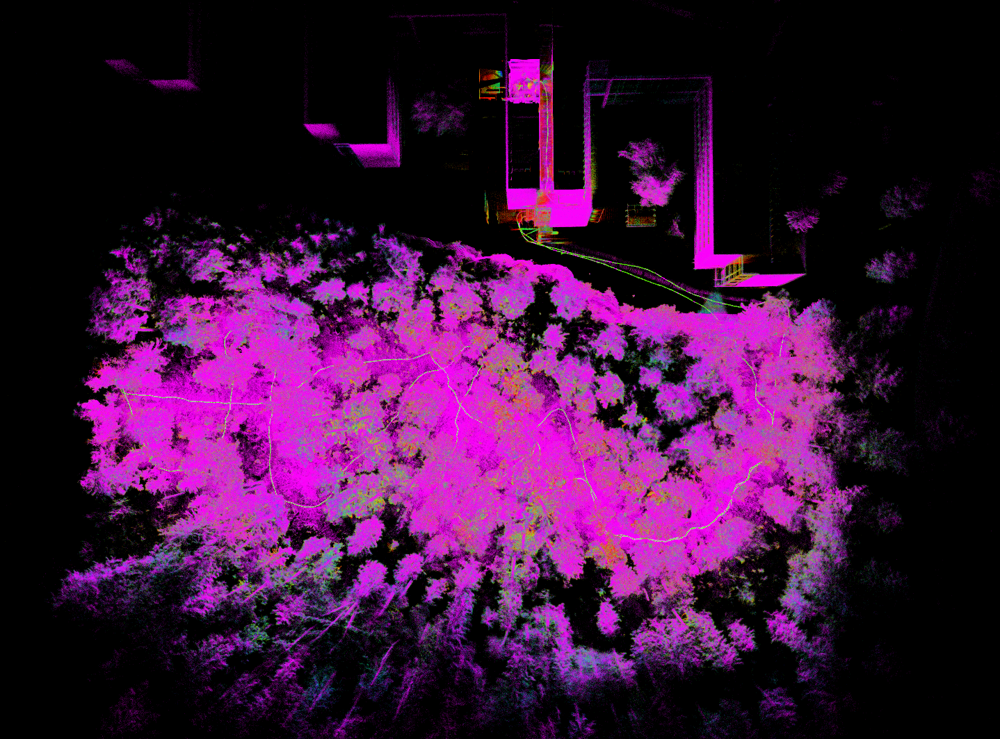
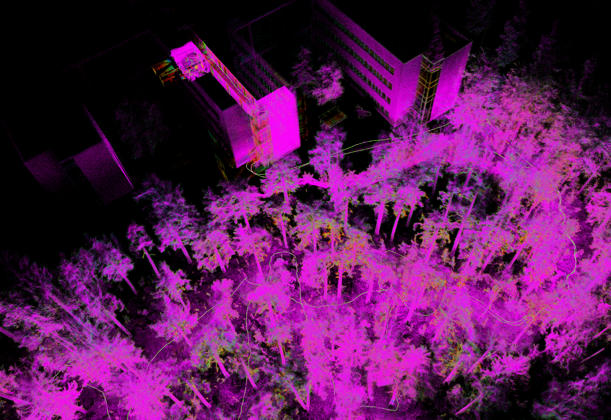

# Perception: AGIptive-LIOM

The v2.0 stack navigates on one odometry source at a time, chosen per run. The same source drives the planner and is sent to PX4's EKF2 as external vision, so the drone flies with no GPS and no compass. On the drone, that source is the LiDAR-inertial odometry (LIO) **AGIptive-LIOM**.

> **Status:** agipix_auto has flown in simulation with ground-truth odometry, and has been demonstrated on LIO in simulation. LIO flight, the Jetson build and real flight are not yet qualified.

## AGIptive-LIOM

Ongoing work · Title tentative

<figure class="two-up">
  
  
  <figcaption>The mapping result of AGIptive-LIOM at Hervanta rock.</figcaption>
</figure>

AGIptive-LIOM is failure-aware LiDAR-inertial odometry for quadrotors.

- **Guards against sensor faults.** Clock steps, a blocked view, starting while moving and an IMU that clips at impacts.
- **Reports its own health.** An onboard health monitor reports OK, DEGRADED or FAILED with every scan.
- **Tells PX4.** The health sets the quality of the vision message sent to PX4, so PX4 stops fusing a failed estimate.

The code will be released once the paper is submitted. See the [AGIptive-LIOM post]({{ '/posts/agiptive-liom/' | relative_url }}) for a real forest flight on AgiPIX.

## Where the odometry goes

- **TF.** One TF node publishes the selected source as `<ns>/world → <ns>/base_link`, with the LiDAR as a fixed `<ns>/lidar_link` below it. Topics follow `/<ns>/<owner>/<signal>`.
- **Planner.** agipix_auto uses the odometry to deskew each scan, build ROG-Map and run the MPC; see [Navigation](./2_planning_control.md).
- **PX4.** The odometry is sent to PX4 as external vision (`vehicle_visual_odometry`). In simulation agipix_auto sends it; on the drone, the PX4 bridge relays it.

## Odometry sources

| Source | Where | Notes |
|---|---|---|
| LiDAR-inertial odometry (AGIptive-LIOM) | drone and simulation | The drone's own estimate from the Mid-360 point cloud and IMU. Demonstrated with agipix_auto in simulation; not yet qualified. |
| Ground truth | simulation only | Pose from the simulator. Used for the measured simulation results. |
| Motion capture | drone and simulation | OptiTrack or Vicon on the drone; an emulator in simulation. Not tested on hardware yet. |

## LiDAR

- **Sensor:** Livox Mid-360 with its built-in IMU, 10 Hz scans. On the drone, the LIO uses the Mid-360's built-in IMU.
- **Mount:** 45° nose-down, fixed. The planner turns the drone so the sensor looks along the direction of travel; see [Navigation](./2_planning_control.md).
- **Time:** on the drone, the LiDAR takes its time from a PTP master on the Jetson. The LIO starts only once the LiDAR clock is in sync. See [Hardware Synchronisation](../real/5_hardware_synchronisation.md).
- **Driver and network setup:** see [Interfacing PX4 and Sensors](../real/4_interfacing_sensors.md).

## Odometry in PX4

- EKF2 is set up for GPS-denied flight: no GPS, no magnetometer fusion, height and heading from external vision. The parameters and the reasons are in [Interfacing PX4 and Sensors](../real/4_interfacing_sensors.md#compass-and-ekf2-heading-gps-denied).
- If external vision is lost, PX4 drops from Position to Altitude mode.
