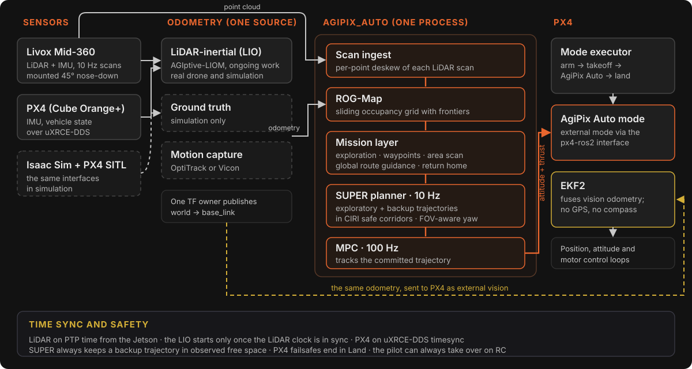

# Autonomy overview

AgiPIX v2.0 replaces the heuristic autonomy stack of v1.1.0 with **agipix_auto**: a single ROS 2 process built around the [SUPER](https://github.com/hku-mars/SUPER) planner from the HKU MaRS Lab. agipix_auto maps the space around the drone with ROG-Map, chooses goals for exploration or a mission, plans fast trajectories with SUPER, and tracks them with an MPC that flies PX4 through a ROS 2 external mode.

> **Status: simulation only.** agipix_auto has flown in simulation (Isaac Sim with PX4 SITL) with ground-truth odometry, and has been demonstrated on LiDAR-inertial odometry (LIO) in simulation. LIO flight, the Jetson Orin NX build and real flight are not yet qualified; the drone is at bench bring-up. The code is not released yet; the launch commands on the [Navigation](./2_planning_control.md#running-it-in-simulation) page require the v2.0.0 development branch.

<figure>
  
  <figcaption>The v2.0 autonomy stack, from sensors to PX4. Select the figure to enlarge it.</figcaption>
</figure>

## How the pieces fit

- **Sensors.** A Livox Mid-360 LiDAR, mounted 45° nose-down, provides 10 Hz scans and an IMU. PX4 runs on a Cube Orange+ and talks to the Jetson over uXRCE-DDS. In simulation, Isaac Sim and PX4 SITL provide the same interfaces.
- **Odometry.** One source is selected per run: LiDAR-inertial odometry (LIO), the simulator's ground truth, or motion capture. One TF node publishes it as `world → base_link`. See [Perception](./1_perception.md).
- **agipix_auto.** Scan ingest, ROG-Map, the mission layer, the SUPER planner and the MPC run in one process, so there is no separate trajectory or offboard node. See [Navigation](./2_planning_control.md).
- **PX4.** agipix_auto registers an external mode, *AgiPix Auto*, and a mode executor that arms, takes off, runs the mission and lands. PX4's EKF2 fuses the same odometry as external vision, with no GPS and no compass.

## In simulation

Both videos show agipix_auto flying autonomously in Isaac Sim. The odometry each one used is given below it.

  <iframe src="https://www.youtube.com/embed/AE3DyyekjHI" title="Autonomous exploration in a pine forest on hilly terrain (Isaac Sim)" frameborder="0" allow="accelerometer; clipboard-write; encrypted-media; gyroscope; picture-in-picture; web-share" allowfullscreen></iframe>

Autonomous exploration in a pine forest on hilly terrain. Simulation, ground-truth odometry.

  <iframe src="https://www.youtube.com/embed/loYrE-hTQr0" title="Autonomous exploration of a nuclear reactor building (Isaac Sim)" frameborder="0" allow="accelerometer; clipboard-write; encrypted-media; gyroscope; picture-in-picture; web-share" allowfullscreen></iframe>

Autonomous exploration of a nuclear reactor building. Simulation, LiDAR-inertial odometry (ongoing work). Environment credit: <a href="https://kenanalperen.github.io/" target="_blank" rel="noopener">kenanalperen.github.io</a>.

### Results in simulation

Measured in Isaac Sim with PX4 SITL. Simulation, ground-truth odometry.

| Test | Result |
|---|---|
| Waypoint flight at up to 5 m/s in an industrial interior | Tracking error 0.08 m (95th percentile), no stops |
| Autonomous exploration of a two-storey building | Both floors, climbing a 5.4 m shaft between them; 662 m in 450 s, mean speed 1.5 m/s, no contact; returned home to within 0.04 m |

Every live flight of that test stage finished without intervention.

## What changed since v1.1.0

| v1.1.0 (heuristic stack) | v2.0 |
|---|---|
| Mission state machines (`autonomous_flight`) | Mission layer inside agipix_auto |
| Occupancy and ESDF map (`map_manager`) | ROG-Map: sliding occupancy grid with frontiers, no ESDF |
| Global and local planners and time optimiser | SUPER: exploratory and backup trajectories in safe corridors, plus global route guidance |
| Offboard control interface (`px4_control_interface`) | MPC inside agipix_auto, flying a PX4 ROS 2 external mode |
| Aerostack2-derived interface packages | Lean PX4 bridge, one TF node, motion-capture input and a terminal viewer |

The v1.1.0 stack is documented in the v1.1.0 docs; select v1.1.0 in the version menu. Dynamic-obstacle detection (`onboard_detector`) is kept but not yet integrated with agipix_auto.

## In this section

- [Perception](./1_perception.md): LiDAR, odometry sources, time sync and how PX4 uses the odometry.
- [Navigation](./2_planning_control.md): agipix_auto, SUPER, ROG-Map, missions and the PX4 interface.
- [Data-driven autonomy](./3_planning_control_data.md): learned navigation policies flown on AgiPIX.

## Credits

- **SUPER** and **ROG-Map**: Yunfan Ren and colleagues, HKU MaRS Lab ([SUPER](https://github.com/hku-mars/SUPER), [ROG-Map](https://github.com/hku-mars/ROG-Map)); both LGPL-3.0-or-later. SUPER includes the CIRI safe-corridor generator.
- **PX4** and the **PX4 ROS 2 interface library** (BSD-3-Clause), the **Pegasus Simulator** and **NVIDIA Isaac Sim** for simulation, and the **Livox** SDK and ROS 2 driver.
- agipix_auto integration and platform engineering: Sasanka Kuruppu Arachchige.
