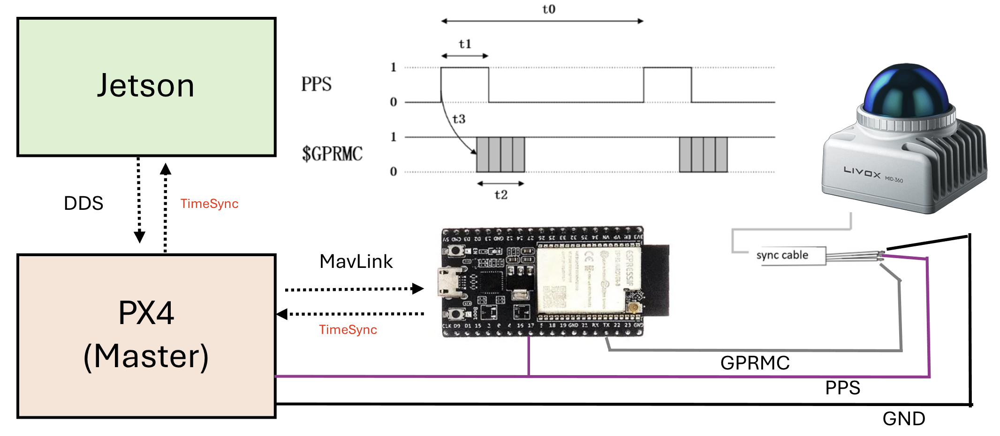

# Hardware Synchronisation: Jetson PTP + ESP32 TimerSync Bridge

> **Updated 2026-11-08.** The LiDAR now takes its time from a **software PTP master on the Jetson**. The ESP32 TimerSync Bridge stays wired as a GPS-style **fallback** time source and drives the PPS-aligned **10 Hz camera trigger**. The original ESP32-only design is kept further down for reference; parts that no longer apply are marked **Superseded (2026-11)**.

## Current Architecture (2026-11)

Every sensor stamp is on one clock: the Jetson's `CLOCK_REALTIME`.

| Clock consumer | Time source | Path |
|---|---|---|
| Livox Mid-360 (point cloud + IMU) | Jetson, **primary** | Software PTP: `ptp4l` as the systemd service `ptp4l-livox.service` on the LiDAR Ethernet port `enP8p1s0` |
| Livox Mid-360 | ESP32, **fallback** ("option B") | 1 PPS (M12 pin 8) + GPRMC (M12 pin 10); the Mid-360 uses it until a PTP master answers |
| PX4 (`/fmu/out/*` stamps) | Jetson | uXRCE-DDS timesync (`UXRCE_DDS_SYNCT=1`) |
| ESP32 TimerSync Bridge | Jetson, through PX4 | MAVLink `SYSTEM_TIME` on GPS2; the custom PX4 build fills it with the DDS-synced companion time |
| Cameras (planned OAK-FFC-4P) | Jetson (host stamps) | Exposure triggered by the ESP32 10 Hz output; PX4 `pps_capture` stamps every trigger edge in Jetson time |

```
                  Jetson Orin NX  (CLOCK_REALTIME = reference clock)
  ┌──────────────────────────────────────────────────────────────────────┐
  │  ptp4l-livox.service        MicroXRCEAgent           ROS 2 stack     │
  │  (software PTP master)      (uXRCE-DDS timesync)     agipix_health   │
  └───────┬─────────────────────────────┬────────────────────────▲───────┘
          │ Ethernet enP8p1s0           │ TELEM2 (uXRCE-DDS)     │ USB, host-stamped
          │ PTP [primary]               ▼                        │ frames (planned)
          │                ┌───────────────────────────┐   ┌─────┴────────────┐
          │                │ PX4, Cube Orange+         │   │ OAK-FFC-4P       │
          │                │ custom v1.17.0            │   │ FSIN (1.8 V)     │
          │                │ SYSTEM_TIME = Jetson time │   └─────▲────────────┘
          │                │ pps_capture on AUX5       │         │ 3.3 V → 1.8 V
          │                └─────┬───────────────▲─────┘         │ level shifter
          │        GPS2 MAVLink  │               │ 10 Hz edges   │
          │        SYSTEM_TIME   ▼               │               │
          │                ┌─────────────────────┴───────────────┴──┐
          │                │ ESP32-S3 TimerSync Bridge              │
          │                │ GPIO 4: 10 Hz trigger   GPIO 5: 1 PPS  │
          │                │ GPIO 12: GPRMC                         │
          │                └─────┬──────────────────────────────────┘
          ▼                      │ PPS + GPRMC [fallback]
  ┌───────────────────────────┐  │
  │ Livox Mid-360             │◄─┘
  │ uses PTP when present     │
  └───────────────────────────┘
```

### Livox time-source priority

The Mid-360 prefers PTP over GPS. `livox_ros_driver2` reports the source in `timestamp_type`:

| `timestamp_type` | Source | Stamps |
|---:|---|---|
| 0 | NoSync | Sensor uptime (not on any host clock) |
| 1 | gPTP / PTP | Jetson `CLOCK_REALTIME` via `ptp4l` |
| 2 | GPS (PPS + GPRMC) | ESP32 disciplined clock (Jetson time through PX4) |

Because PTP wins, the ESP32 PPS and GPRMC wires can stay connected.

Observed behaviour on the drone (2026-11-09):

- After a LiDAR power cycle, the Mid-360 reports GPS time for about 5 s, then switches to PTP.
- If the PTP master stops, the Mid-360 stays in PTP holdover (drift about 7 µs/s). It did not fall back to GPS in the 60 s tested; longer holdover has not been measured.
- It re-locks within about 7 s of the master coming back.

---

## Primary: Software PTP from the Jetson

The Mid-360 supports IEEE 1588 (PTP). The Jetson's LiDAR Ethernet port (`enP8p1s0`, `r8168` driver) has no PTP hardware clock (PHC), so hardware-timestamped PTP is not possible. **Software** timestamping works and is accurate enough: on the bench the median Livox IMU arrival−stamp was 0.5 ms.

`ptp4l` runs on the **host** (not in the container) as a systemd service:

```bash
/usr/sbin/ptp4l -i enP8p1s0 -S -4 -E -m --masterOnly 1 --tx_timestamp_timeout 100
```

| Option | Why |
|---|---|
| `-i enP8p1s0` | The Ethernet port the Mid-360 is on |
| `-S` | Software timestamps (the `r8168` NIC has no PHC) |
| `-4` | PTP over UDP/IPv4 |
| `-E` | End-to-end delay mechanism |
| `-m` | Log to stdout, so the messages land in the journal |
| `--masterOnly 1` | The Jetson is always the master; it never syncs itself to the LiDAR |
| `--tx_timestamp_timeout 100` | Wait up to 100 ms for the software TX timestamp. With the default (1 ms) `ptp4l` went `FAULTY` within ~81 s ("timed out while polling for tx timestamp") and stayed faulty, leaving the LiDAR in holdover |

### Install

Save the unit as `ptp4l-livox.service`:

```ini
[Unit]
Description=Software PTP master for the Livox Mid-360 on enP8p1s0 (agipix)
After=network-online.target
Wants=network-online.target
[Service]
ExecStart=/usr/sbin/ptp4l -i enP8p1s0 -S -4 -E -m --masterOnly 1 --tx_timestamp_timeout 100
Restart=always
RestartSec=2
[Install]
WantedBy=multi-user.target
```

Then, on the Jetson host:

```bash
sudo apt install linuxptp
sudo install -m 644 ptp4l-livox.service /etc/systemd/system/
sudo systemctl daemon-reload && sudo systemctl enable --now ptp4l-livox.service
```

### Check

```bash
systemctl status ptp4l-livox
journalctl -u ptp4l-livox -f
```

- The port goes `LISTENING` → `MASTER` a few seconds after start and stays `MASTER`. A `FAULTY` state means the TX-timestamp timeout was hit (see [Troubleshooting](#troubleshooting)).
- The Mid-360 switches to PTP within a few seconds: the driver logs `timestamp_type changed to 1`, and `livox/time_sync` reads `1`.
- In the stack, `<ns>/time_sync/lidar` shows source PTP and `synced=true` (see [Stack Integration](#stack-integration-time-sync-health)).

### Uninstall

```bash
sudo systemctl disable --now ptp4l-livox.service
sudo rm /etc/systemd/system/ptp4l-livox.service
sudo systemctl daemon-reload
```

> **Host clock steps:** `ptp4l` serves the host `CLOCK_REALTIME`, so a step of the host clock (for example `systemd-timesyncd` correcting the clock at boot) moves the LiDAR time with it. Start the stack after the host clock has settled; `agipix_health` reports steps under `<ns>/time_sync/host_clock`.

---

## Fallback: ESP32 TimerSync Bridge (option B)

The ESP32 now has two jobs:

1. **GPS-style fallback time source** for the Mid-360: 1 PPS on GPIO 5 / A1 (M12 pin 8, 100 ms high) and GPRMC on GPIO 12 (M12 pin 10). The LiDAR uses them until a PTP master answers; if the master stops later, it stays in PTP holdover instead of returning to them.
2. **PPS-aligned 10 Hz camera trigger** on GPIO 4 / A0 (50 % duty, phase-reset at every PPS edge). See [Camera Trigger and PX4 Trigger Capture](#camera-trigger-and-px4-trigger-capture).

The ESP32 disciplines its clock to the PX4 flight controller via MAVLink `SYSTEM_TIME` over UART. With the custom PX4 build (patch 02, [below](#px4-custom-firmware-v1170-cube-orange)), `SYSTEM_TIME` carries the Jetson time, so the ESP32 locks to the Jetson clock as well.

> **Superseded (2026-11):** the original design assumed the Jetson could not do PTP and used the ESP32 as the only LiDAR time source. As described above, software PTP works on the Jetson and is now the primary source.

The ESP32 firmware code can be found at [TimerSyncBridge](https://github.com/SasaKuruppuarachchi/esp32_timersync-open.git). The 2026-11 fixes (E1–E5, firmware label `sync-fixes-2026-11`) are on `master`.



### ESP32 Firmware Update (`sync-fixes-2026-11`)

Commit `290e721` ("Sync fixes E1-E5"). It pairs with PX4 patch 02, so the `SYSTEM_TIME` source is the Jetson clock and can step (PX4 reboot, Jetson clock step).

| ID | Change |
|---|---|
| E1 | **PPS off until LOCKED.** The PPS pin stays low until the clock is locked. The first edge after any (re)lock is armed on a whole disciplined second (at least 300 ms ahead and 1.2 s after any earlier edge), and its GPRMC is skipped. No more mislabelled first second. |
| E2 | **Step detection and holdover.** A min-filtered phase error above 20 ms puts the clock in `STEP_PENDING` (outputs continue on the held clock). If the step persists for 20 s (hold-off) the firmware re-seeds: outputs off → `WARMING` → `LOCKED`. A PX4 reboot rides through without a re-seed. No `SYSTEM_TIME` for 3 s → `HOLDOVER` on the frequency estimate; after 10 min → `UNLOCKED`, outputs off. The old `>1e15 µs` gate and the `DEGRADED` state are removed. |
| E3 | **Better timestamps and a PI loop.** A UART RX task stamps the start of each `SYSTEM_TIME` frame (no `delay(20)` polling). A min-filter over blocks of 16 samples (~8 s) keeps the lowest-delay sample, and a PI loop (Kp 0.2, Ki 0.02) steers the clock rate (slew ≤ 500 ppm). The clock never steps while locked. Replaces the ±500 µs bang-bang slew. |
| E4 | Optional reply to PX4 `TIMESYNC` requests (`ENABLE_TIMESYNC_REPLY=1`). **Off by default**: at 57600 baud the round trip alone is ~10 ms, which PX4 rejects. |
| E5 | **Thread safety and PPS shape.** One spinlock guards the shared clock model; no console prints in the PPS callback; GPRMC is sent by a task within a few ms of the edge (dropped if > 800 ms late). PPS high time is 100 ms (Livox recommends 10–200 ms; was 500 ms). |

Also: the platform is pinned to `espressif32@6.12.0` (Arduino core 2.0.17), build options are listed in `platformio.ini`, and `test/host_sim/` runs `main.cpp` against synthetic `SYSTEM_TIME` on the host. Pins and the GPRMC format are unchanged.

---

## System Architecture (ESP32)

```
                          ┌─────────────────────────────────────┐
                          │   DFRobot FireBeetle 2 ESP32-S3     │
                          │                                     │
  PX4 Flight Controller   │  ┌──────────────────────────────┐   │
  (DDS time source)       │  │  Clock Discipline Layer      │   │
  GPS2  UART  ◄──────────►│  │  UNLOCKED → WARMING → LOCKED │   │
  GPIO 38/3               │  │  Source: SYSTEM_TIME MAVLink │   │
  57600 baud              │  └──────────┬───────────────────┘   │
                          │             │ UTC epoch              │
                          │  ┌──────────▼───────────────────┐   │
                          │  │  Output Generation           │   │
                          │  │  • 10 Hz PWM  GPIO 4 (LEDC)  │   │
                          │  │  • 1 Hz PPS   GPIO 5 (timer) │   │
                          │  │  • GPRMC      GPIO 12 UART1  │   │
                          │  └──┬──────────┬────────────────┘   │
                          └─────┼──────────┼──────────────────┘
                                │          │
               ┌────────────────┘          └──────────────────────────┐
               ▼                                                       ▼
  ┌────────────────────┐                          ┌────────────────────────────┐
  │  Camera trigger    │                          │  Livox Mid-360             │
  │  OAK-FFC-4P FSIN   │                          │  LiDAR                     │
  │  (planned; earlier │                          │  Pin 8: PPS (Purple/white) │
  │  Hikrobot MVS)     │                          │  Pin 10: GPS/GPRMC         │
  │  + PX4 AUX5 capture│                          │    (Gray/white, UART 9600) │
  └────────────────────┘                          │  → UTC LiDAR stamps        │
                                                  └────────────────────────────┘
```

### Signal timing relationship

```
  1 Hz sync (GPIO 5)    ───┐           ┌───         ┌───
                           └───────────┘           └───
                           ▲ rising edge = UTC second boundary
                           │
  10 Hz trigger (GPIO 4)  ─┐─┐─┐─┐─┐  ←─ phase-reset here ─► ─┐─┐─┐─┐─┐
                            │ │ │ │ │                            │ │ │ │ │
                           100ms period, 50% duty

  GPRMC (GPIO 12 UART1)   ──[HHMMSS.00,A,...]──────────────────[HH:MM:SS+1,A,...]──
                           ▲ emitted on same rising edge
```

Every 1 Hz rising edge: LEDC timer reset (phase-aligns 10 Hz) → GPRMC for that second, sent by a task within a few ms of the edge (the Livox window is 0–900 ms).

With the 2026-11 firmware the PPS is **100 ms high** (was 50 % duty) and stays **off until LOCKED**. The 10 Hz trigger free-runs from boot and is phase-aligned to the PPS once the PPS runs.

---

## Hardware

| Component | Part |
|---|---|
| Timing board | DFRobot FireBeetle 2 ESP32-S3 |
| LiDAR | Livox Mid-360 |
| Camera | OAK-FFC-4P (planned; FSIN trigger). Earlier: Hikrobot MVS (TriggerSource=LINE0) |
| Flight controller | PX4 custom v1.17.0 on Cube Orange+ (time sourced from companion via DDS, no GPS) |

---

## GPIO Pinout (as-built)

| Function | GPIO | Direction | Destination |
|---|---:|---|---|
| 10 Hz camera trigger | 4 (A0) | OUT | Cube FMU AUX5 (`pps_capture`); planned OAK-FFC-4P FSIN via a 3.3 V → 1.8 V level shifter. Earlier: MVS camera Line0 OPTO_IN |
| 1 Hz PPS sync | 5 (A1) | OUT | Mid-360 M12 PPS interface (Pin 8, purple/white) (direct TTL, 100 ms high) |
| GPRMC UART1 TX | 12 | OUT | Mid-360 M12 GPS input (Pin 10, Gray/white, UART 9600) |
| GPRMC UART1 RX | 13 | IN | Reserved, unused |
| MAVLink UART2 TX | 38 | OUT | PX4 GPS2 RX |
| MAVLink UART2 RX | 3 | IN | PX4 GPS2 TX |
| Status LED | 2 | OUT | On-board LED: fast blink UNLOCKED, double blink WARMING, 50 ms per second LOCKED, triple blink STEP_PENDING / HOLDOVER |

---

## Px4 setup

Update the following parameters on PX4 to enable MAVLink time sync over UART2.
For reference, the project uses the GPS2 port on PX4, so the parameters are:

```
MAV_1_CONFIG=GPS2
SER_GPS2_BAUD=57600
SER_GPS2_PROTO=1  # MAVLink v2
SER_GPS2_OPTIONS=0  # No flow control, no 9-bit, etc

UXRCE_DDS_SYNCT=1
```

For the trigger capture on AUX5 (custom firmware, patch 03):

```
PPS_CAP_ENABLE=1      # reboot needed
PWM_AUX_FUNC5=2064    # AUX5 = PPS input
```

### PX4 Custom Firmware (v1.17.0, Cube Orange+)

The drone runs PX4 v1.17.0 with three small patches. Build and flashing steps, and the full parameter notes (including `EKF2_MAG_TYPE=5`), are in [Interfacing PX4 and Sensors](./4_interfacing_sensors.md).

| Patch | Change | Why |
|---|---|---|
| 01 | uXRCE-DDS `rate_limit` of `/fmu/out/sensor_combined` raised to 400 Hz | The PX4 IMU reaches the Jetson at the full integration rate (~200 Hz) instead of 100 Hz |
| 02 | MAVLink `SYSTEM_TIME` sends the DDS-synced companion time: hrt minus the converged uXRCE-DDS offset. After a link drop it holds the last offset; before the first convergence it is stock (`CLOCK_REALTIME`) | The ESP32 locks to Jetson time, the same clock as every `/fmu/out` stamp |
| 03 | `pps_capture` driver enabled on the board and exported over DDS as `/fmu/out/pps_capture` | PX4 timestamps the ESP32 trigger edges in Jetson time. Only `timestamp` is meaningful; `rtc_timestamp` assumes a GNSS receiver |

---

## Camera Trigger and PX4 Trigger Capture

- **Trigger:** ESP32 GPIO 4 / A0, 10 Hz, 50 % duty, phase-reset at every PPS edge, so its rising edges fall on whole 100 ms steps of the disciplined clock.
- **OAK-FFC-4P (planned):** FSIN input on the 7-pin connector, pins 5/6 (one per camera pair), at **1.8 V** logic. The ESP32 drives 3.3 V, so a level shifter is needed. STROBE output is on pin 2. The OAK is USB only and has no PTP; its frames are stamped by the host, and the trigger sets *when* they are exposed.
- **PX4 capture:** wire ESP32 GPIO 4 to the Cube FMU **AUX5** signal pin, with a common ground. With `PPS_CAP_ENABLE=1` and `PWM_AUX_FUNC5=2064`, PX4 timestamps every trigger edge and publishes it as `/fmu/out/pps_capture`; its `timestamp` is already in Jetson time. AUX5 is on Timer4, separate from the motors on AUX1–4. At 10 Hz the driver's rate-exceeded counter stayed at 0.
- Keep `SENS_EN_LL40LS=0` and `FD_EXT_ATS_EN=0` (both also use AUX5 through `pwm_input`), and `TRIG_MODE=0`, `CAM_CAP_FBACK=0`.

```bash
ros2 topic hz /fmu/out/pps_capture   # ~10 Hz with the trigger wired
```

---

## Full Wiring Diagram

```
  FireBeetle 2 ESP32-S3
  ┌─────────────────────────────────────────────────────┐
  │                                                     │
  │  GPIO 4 / A0 ──────────┬───────────────────────────►│  Camera FSIN (OAK-FFC-4P, planned,
  │  (10 Hz PWM 50% duty)  │                            │  via 3.3 V → 1.8 V level shifter)
  │                        └───────────────────────────►│  Cube FMU AUX5 signal (pps_capture)
  │                                                     │  (earlier: MVS Line0 OPTO_IN PIN 2)
  │                                                     │
  │  GPIO 5 / A1 ──────────────────────────────────────►│  Livox Mid-360
  │  (1 Hz PPS TTL, 100 ms high)                        │  M12 PPS interface (Pin 8, Purple/white)*
  │                                                     │  
  │  GPIO 12 (UART1 TX) ──┐────────────────────────────►│  M12 GPS input (Pin 10, Gray/white, UART 9600)*
  │  GPIO 13 (UART1 RX) ──┤                             │             
  │  (9600 baud GPRMC)    │                             │
  │                       ▼                             │
  │                  USB-Serial adapter                 │
  │                       │                             │
  │                       ▼                             │
  │                  Host /dev/ttyUSB0                  │
  │                  (to debug)                         │
  │                                                     │
  │  GPIO 38 (UART2 TX)  ──────────────────────────────►│  PX4 GPS2 RX
  │  GPIO  3 (UART2 RX)  ◄──────────────────────────────│  PX4 GPS2 TX
  │  (57600 baud MAVLink)                               │
  │  GND ───────────────────────────────────────────────│  PX4 GND (also the AUX5 ground)
  │                                                     │
  │  USB-C (USB-CDC) ──────────────────────────────────►│  Host /dev/ttyACM0
  │  (115200 baud console)                              │  pio device monitor
  │                                                     │
  └─────────────────────────────────────────────────────┘
```
*(direct TTL for Mid-360 or when using the Livox converter 2.0, but RS485 is needed when using other LiDARs )
> **Mid-360 PPS note:** The Mid-360 accepts direct TTL on its M12 PPS interface. No TTL-to-RS485 converter is required.

> **UART TX/RX crossing:** GPIO 38 (TX) → PX4 GPS2 RX, GPIO 3 (RX) ← PX4 GPS2 TX. Cross the wires. Shared GND is mandatory.

---

## Clock Discipline Flow

Firmware `sync-fixes-2026-11`:

```
  Power on            PPS + GPRMC off, 10 Hz trigger free-running
      │
      ▼
  UNLOCKED ── first SYSTEM_TIME ───────────────────────────► WARMING

  WARMING  ── 6 samples (~3 s), two best agree within 10 ms ► LOCKED (seeded)
           ── no SYSTEM_TIME for 3 s ──────────────────────► UNLOCKED

  LOCKED   ── PPS + GPRMC on; first edge on a whole second, its GPRMC skipped
              PI discipline on min-filtered blocks (16 samples, ~8 s); never steps
      │
      ├── block phase error > 20 ms ───► STEP_PENDING (outputs continue on the held clock)
      │       back within 20 ms ───────► LOCKED (no re-seed)
      │       persists 20 s ───────────► re-seed: outputs off → WARMING → LOCKED
      │
      └── no SYSTEM_TIME for 3 s ──────► HOLDOVER (outputs continue on the frequency estimate)
              SYSTEM_TIME back ────────► LOCKED
              10 min without ──────────► UNLOCKED (outputs off)
```

### Superseded (2026-11): original Phase 4 flow

```
  Power on
      │
      ▼
  UNLOCKED ──── no SYSTEM_TIME with valid epoch ────► UNLOCKED
      │
      │  SYSTEM_TIME.time_unix_usec > 1e15 µs (DDS converged)
      ▼
  WARMING ──── 3 consecutive SYSTEM_TIME samples ────► seed epoch, step-correct each
      │
      │  3 samples accumulated
      ▼
  LOCKED ──── ongoing SYSTEM_TIME updates ───────────► slew ±500 µs/update (D6)
      │                                                 GPRMC emits disciplined UTC
      │  DDS link lost
      ▼
  DEGRADED ── DDS re-converges ──────────────────────► WARMING (re-seeds)

  GPRMC output:  LOCKED → disciplined UTC sentences
                 all other states → suppressed (no output)

  1 Hz pulse and 10 Hz trigger: always running regardless of lock state
```

---

## Build and Flash

### Prerequisites
- PlatformIO (`pip install -U platformio`) or the VS Code PlatformIO extension
- `duracopter/MAVLink v2 C library@^2.0` (already in `platformio.ini`)
- Platform pinned to `espressif32@6.12.0` (Arduino core 2.0.17) since `sync-fixes-2026-11`

> **Ubuntu's apt `platformio` (4.3.4) does not work** with newer `click`: it crashes with `'PlatformioCLI' object has no attribute 'resultcallback'`. Install a current PlatformIO with `pip install -U platformio`, or flash prebuilt images with esptool (below).

### Flash
```bash
git checkout master && git pull
pio run -t upload
```

### Flash prebuilt images with esptool (no PlatformIO CLI)

Use the esptool that PlatformIO installed, with the images from a build (`.pio/build/dfrobot_firebeetle2_esp32s3/`):

```bash
python3 ~/.platformio/packages/tool-esptoolpy/esptool.py --chip esp32s3 --port /dev/ttyACM0 --baud 460800 \
  write_flash -z --flash_mode keep --flash_freq keep --flash_size keep \
  0x0 bootloader.bin \
  0x8000 partitions.bin \
  0xe000 ~/.platformio/packages/framework-arduinoespressif32/tools/partitions/boot_app0.bin \
  0x10000 firmware.bin
```

If it does not connect, hold **BOOT**, press **RST**, release **BOOT**, and run it again.

### Monitor USB-CDC console
```bash
pio device monitor -b 115200
```

### Verify LiDAR time sync
With `ptp4l` running the LiDAR uses PTP (`timestamp_type changed to 1`).

Stopping `ptp4l` alone does not trigger the ESP32 fallback: with `ptp4l` stopped for 60 s and the driver left running, the Mid-360 stayed on `timestamp_type` 1 (PTP holdover). To test the fallback, power-cycle the LiDAR as well.

> **Expected, to be confirmed:** this exact sequence has not been run yet.

1. Stop the PTP service: `sudo systemctl stop ptp4l-livox`
2. Power-cycle the LiDAR.
3. After it boots, `timestamp_type` should read 2 (GPS, ESP32 fallback) and stay 2 while `ptp4l` is stopped. The GPRMC signal goes directly to the LiDAR (M12 pin 10). The `livox_ros_driver2` log shows:
   ```
   timestamp_type changed to 2
   ```
4. Start the PTP service again: `sudo systemctl start ptp4l-livox`
5. `timestamp_type` should switch back to 1 within seconds.

---

## Expected Console Output

### Startup banner (`sync-fixes-2026-11`, default build options)
```
=== ESP32-S3 LiDAR time sync, branch sync-fixes-2026-11 ===
PPS GPIO 5 (100 ms high, off until LOCKED); GPRMC TX GPIO 12 @ 9600; 10 Hz trigger GPIO 4
MAVLink UART2 TX 38 RX 3 @ 57600; SYSTEM_TIME fixed delay 0 us; TIMESYNC reply off
Discipline: seed 6 samples, min-filter blocks of 16, PI Kp=0.20 Ki=0.02, step 20000 us, hold-off 20 s
```

### Log tokens

| Token | Content |
|---|---|
| `[S]` | Every `SYSTEM_TIME` sample: ESP time of the frame start, source time, `o` = source − disciplined |
| `[BLK]` | Every min-filter block: `theta` = phase error of the best sample, plus rate and frequency |
| `[PPS]` | Every edge: label, spin error, interval, GPRMC counters |
| `[CLK]` | State changes, e.g. `[CLK] UNLOCKED -> WARMING (SYSTEM_TIME received)`, then `[CLK] seeded ...` and `[CLK] WARMING -> LOCKED (seeded)` |
| `[HB]` | Every 10 s: state, epoch, samples, re-seeds, theta, rate, frequency |
| `[MAV]` | PX4 reboot detected (`time_boot_ms` went back) |

After lock, the first `[PPS]` line shows `skip1=1` and `interval=0` (first GPRMC skipped), then `interval≈1000000` us.

### Superseded (2026-11): Phase 4 firmware output

#### Startup banner (Phase 4)
```
=== ESP32-S3 Phase 4 Timing Firmware ===
Board: DFRobot FireBeetle2 ESP32-S3
10Hz PWM trigger: GPIO 4 (LEDC low-speed timer0, 50% duty)
1Hz sync pulse:   GPIO 5 (esp_timer 500ms toggle, 50% duty)
GPRMC UART1:      TX GPIO 12, RX GPIO 13 @ 9600 baud
MAVLink UART2:    TX GPIO 38, RX GPIO 3 @ 57600 baud
DDS sync gate:    SYSTEM_TIME unix_us > 1e15 us (year >2001)
Clock discipline: UNLOCKED -> WARMING(3 samples) -> LOCKED
Max slew:         500 us/update  (D6 monotonic invariant)
GPRMC output:     disciplined UTC when LOCKED, suppressed otherwise
Invariant: on each 1Hz rising edge -> LEDC timer reset + monotonic time increment + GPRMC emit
```

#### Before DDS lock (UNLOCKED/WARMING)
```
[1Hz] free=00:00:01 - GPRMC SUPPRESSED (clk=UNLOCKED), 10Hz phase reset
[MAV] HEARTBEAT sysid=1 compid=1 type=2 autopilot=12 base_mode=0x1D state=0
[MAV] SYSTEM_TIME unix_us=1780491609038000 boot_ms=2498713  dds=CONVERGED
[MAV] *** PX4 DDS timesync: CONVERGED — clock is valid ***
[CLK] state=WARMING sample=1/3  seed_unix_us=1780491609038000
[1Hz] free=00:00:02 - GPRMC SUPPRESSED (clk=WARMING), 10Hz phase reset
[CLK] state=WARMING sample=2/3  offset=1711 us
[CLK] state=WARMING sample=3/3  offset=-15801 us
[CLK] *** state=LOCKED — disciplined clock valid ***
```

#### After LOCKED
```
[1Hz] disc=13:00:15 free=00:00:08 - GPRMC emitted (LOCKED), 10Hz phase reset
[CLK] state=LOCKED  disc_utc=13:00:16  offset=-1178 us  corr=-500 us  total_corr=-500 us  drift_trend=14623 us
[HB] uptime=10s  free=00:00:10  disc_utc=13:00:17  clk=LOCKED  px4_dds=CONVERGED
[MAV] TIMESYNC RTT=20639 us
```

### GPRMC output (GPIO 12 → Mid-360 pin 10, 9600 baud, after LOCKED)
```
$GPRMC,130015.00,A,2237.496474,N,11356.089515,E,0.0,225.5,230520,2.3,W,A*2E
$GPRMC,130016.00,A,2237.496474,N,11356.089515,E,0.0,225.5,230520,2.3,W,A*2D
$GPRMC,130017.00,A,2237.496474,N,11356.089515,E,0.0,225.5,230520,2.3,W,A*2C
```
Time field reflects the disciplined time from PX4 (Jetson time with the custom PX4 build). Checksum is valid NMEA XOR. Status field is `A` (active). The GPRMC format is unchanged in the 2026-11 firmware.

---

## livox_ros_driver2 Configuration

No driver setting selects the time source: the Mid-360 uses PTP when a master answers on its Ethernet link, and GPS (PPS + GPRMC) otherwise. For the GPS path the ESP32 acts as a GPS emulator — it provides both the 1 Hz PPS hardware edge (Mid-360 pin 8) and the GPRMC sentence (Mid-360 pin 10) directly. No host serial adapter is needed.

Reference: [Livox time sync via UART](https://livox-wiki-en.readthedocs.io/en/latest/tutorials/new_product/common/time_sync.html#synchronization-via-uart)

The driver validates: `$GPRMC`/`$GNRMC` prefix, status field `A`, and checksum. It does **not** validate position or that the UTC value is current.

### Driver fork changes (2026-11)

The fork used on the drone ([livox_ros_driver2](https://github.com/SasaKuruppuarachchi/livox_ros_driver2)) has two time-sync fixes:

- **Frame cutting in synced mode fixed.** With a time source active, the driver cut a frame only when a packet time had `ms % 100 == 0`. When that packet was missed, 2–6 frames were merged into one cloud (up to 600 ms). It now cuts when the packet time crosses into the next 100 ms slot: 10.00 Hz, every frame on a 100 ms boundary.
- **`livox/time_sync` topic** (`std_msgs/UInt8`, latched): the `timestamp_type` of the last packet (0 NoSync, 1 PTP, 2 GPS); 255 = no packet yet.

### Verification
After launching `livox_ros_driver2`, look for this log entry:
```
timestamp_type changed to 1
```
`timestamp_type 1` = PTP active (primary). `2` = GPS/UART sync active (ESP32 fallback). If it reads `0`, neither source is reaching the LiDAR: check `ptp4l-livox` first, then the GPIO 12 → pin 10 wire and GND continuity.

```bash
ros2 topic echo --once livox/time_sync   # data: 1 with PTP (prefix the driver namespace)
```

---

## Stack Integration: Time-Sync Health

The `agipix_health` node publishes `/diagnostics` (`diagnostic_msgs/DiagnosticArray`, 1 Hz):

| Status | Content |
|---|---|
| `<ns>/time_sync` | Summary: the worst of the three below |
| `<ns>/time_sync/lidar` | `source`, `timestamp_type`, `host_offset_ms`, `synced`, `synced_for_s`, `jumps`, `last_jump`, `lost_after_sync`, … OK when the LiDAR stamps are on the host clock (median receive − stamp within 50 ms) for 3 s |
| `<ns>/time_sync/px4` | uXRCE-DDS timesync converged, round-trip time, observed − estimated offset error |
| `<ns>/time_sync/host_clock` | Kernel NTP flag, host clock steps (> 10 ms in the last 60 s) |

The status is shown in the terminal viewer (`agipix_viewer`) and in the Foxglove layout (diagnostics panels).

The hardware tmux session runs `agipix_health` and holds the LIO (LiDAR-inertial odometry) start with `wait_time_sync` until the LiDAR stamps are on the host clock. Press Enter in that pane to start anyway; `AGIPIX_LIDAR_SYNC_WAIT=false` disables the wait.

Why: a LIO started on unsynced stamps (NoSync, sensor uptime) is broken by the ~1.8e9 s jump when sync arrives and must be restarted. A switch between GPS and PTP moves the stamps by only a few ms and is harmless. `lost_after_sync` (error) flags both cases: the LiDAR lost its sync, or the LIO is still off the host clock after a jump.

---

## Bench Comparison: PTP vs ESP32/GPS (2026-11-08)

Props off, same drone, one session per time source.

| | PTP (primary) | ESP32 / GPS (option B) |
|---|---|---|
| Livox IMU median arrival − stamp | 0.5 ms | 2.2 ms |
| LIO accuracy | the same | the same |

- **Trigger capture** (ESP32 GPIO 4 → AUX5): 10 Hz edges, edge-to-edge jitter ~5 µs, none missed in 220 s. The ESP32 servo was still converging during that run (trigger residual −0.38 → +0.28 ms over 220 s).
- **Dominant error in both:** PX4's uXRCE-DDS timesync estimate is biased by a few ms, and the bias changes per session (−3.5 to +1.7 ms observed; Cube clock 11–24 ppm off the Jetson). Option B inherits it, because the ESP32 follows PX4's estimate of Jetson time.
- **Decision:** PTP is permanent for the LiDAR. It ties the LiDAR to the Jetson clock, which the host-stamped cameras also use. The ESP32 stays as fallback and camera trigger.

---

## Project Status

| Phase | Description | Status |
|---|---|---|
| 1 | ESP32 board bring-up — LEDC 10 Hz, 1 Hz PPS, free-running GPRMC | ✅ COMPLETE |
| 2 | MAVLink link bring-up — HEARTBEAT, SYSTEM_TIME, TIMESYNC via UART2 | ✅ COMPLETE |
| 3 | Clock discipline — DDS-gated UNLOCKED→WARMING→LOCKED state machine | ✅ COMPLETE |
| 4 | Disciplined GPRMC — UTC time from PX4 drives GPRMC output | ✅ COMPLETE — 32 min soak verified (offset ±13 ms, zero DEGRADED, ~16 µs/min drift) |
| 5 | Full integration — Mid-360 + MVS camera end-to-end | ✅ COMPLETE — PPS sync active, `timestamp_type changed to 2` confirmed |
| 6 | 2026-11 rework — software PTP primary; ESP32 firmware E1–E5 + PX4 `SYSTEM_TIME`/`pps_capture` patches (fallback + 10 Hz trigger); time-sync health in the stack | ✅ COMPLETE — bench-tested 2026-11-08 |

---

## Phase 4 Soak Results (32-minute pre-Phase-5 run)

> **Superseded (2026-11):** measured with the Phase 4 firmware (parse-time stamps, ±500 µs bang-bang slew) and PX4 `CLOCK_REALTIME` as the source. The 2026-11 firmware and PX4 patch 02 replace both; see [Bench Comparison](#bench-comparison-ptp-vs-esp32gps-2026-11-08).

Continuous run with PX4 DDS active, no sensor hardware connected yet.

| Metric | Observed | Pass threshold |
|---|---|---|
| Clock state | LOCKED throughout | no DEGRADED transitions |
| Uptime | 1931 s (32 min) | — |
| GPRMC gaps | 0 | 0 |
| LOCKED offset range | ±13 ms | < ±50 ms (UART jitter) |
| Accumulated drift correction | −31 ms over 32 min (~16 µs/min) | stable tracking |
| MAVLink RTT | 20.6 ms (stable) | < 100 ms |
| px4_dds status | CONVERGED throughout | CONVERGED |

Representative log extract (uptime 1931 s):
```text
[HB] uptime=1931s  free=00:32:12  disc_utc=13:32:19  clk=LOCKED  px4_dds=CONVERGED
[CLK] state=LOCKED  disc_utc=13:32:20  offset=-12605 us  corr=-500 us  total_corr=-32166 us
[MAV] TIMESYNC RTT=20636 us
```

**Result: PASS.** Clock discipline is stable over the soak window. Proceeding to Phase 5.

## Phase 5 Integration Checklist

> **Superseded (2026-11):** the LiDAR now runs on PTP (ESP32 = fallback), the 2026-11 firmware has no `DEGRADED` state, and the MVS camera is replaced by the planned OAK-FFC-4P. Kept for the ESP32-fallback wiring.

Connect the Mid-360 LiDAR and MVS camera to the ESP32 and run the full sensor stack.

**Step 1 — Wiring**
- GPIO 5 → Mid-360 M12 pin 8 (PPS, Purple/white, direct TTL 3.3V, no RS485)
- GPIO 12 UART1 TX → Mid-360 M12 pin 10 (GPS input, Gray/white, direct TTL 3.3V)
- GPIO 4 → MVS camera Line0 OPTO_IN
- Shared GND between ESP32 and Mid-360 M12 connector

**Step 2 — Host config**
- No serial adapter needed — GPRMC goes directly to LiDAR hardware
- Set camera: `TriggerMode=1`, `TriggerSource=LINE0`, `ExposureTime=5000`

**Step 3 — Launch**
- Flash ESP32 (`pio run -t upload`)
- Wait for `[CLK] *** state=LOCKED` in console before starting ROS nodes
- Launch `livox_ros_driver` and MVS camera driver

**Verification gate:**
- [ ] `livox_ros_driver2` log shows `timestamp_type changed to 2` on startup
- [ ] LiDAR point cloud timestamps are UTC-anchored (`sec` matches current UTC, not boot-relative)
- [ ] MVS camera triggers at 10 Hz confirmed in ROS topic
- [ ] 30-minute continuous run — no DEGRADED transitions in ESP32 console log
- [ ] Rosbag captured for evidence

---

## Troubleshooting

| Symptom | Likely cause | Fix |
|---|---|---|
| `ptp4l-livox` goes `FAULTY` ("timed out while polling for tx timestamp") | Default 1 ms TX-timestamp timeout with software timestamps | Use `--tx_timestamp_timeout 100` (as in the unit file) |
| Driver reports `timestamp_type` 0 | No PTP master and no GPS fallback | `systemctl status ptp4l-livox`; check the Ethernet link; then the ESP32 state and the GPIO 5 / GPIO 12 wires |
| "PX4 DDS offset error" of a few ms to 20+ ms just after boot | The Jetson's NTP is adjusting the clock quickly (about 130 ppm seen) | Expected; it clears once the clock settles |
| LIO start held at `wait_time_sync` | LiDAR stamps not yet on the host clock | Check the two rows above; Enter in the pane overrides |
| LiDAR time jumped with no sync change | Host clock stepped (e.g. timesyncd at boot); PTP serves the host clock | Check `<ns>/time_sync/host_clock`; restart the LIO if it was already running |
| No `[MAV]`/`[S]` lines | UART2 wiring wrong or baud mismatch | Check GPIO 38→PX4 RX, GPIO 3←PX4 TX, shared GND; verify `SER_GPS2_BAUD=57600` on PX4 |
| Stays in WARMING, or `[CLK] seed rejected` repeats | `SYSTEM_TIME` stops or is very noisy | Check the GPS2 link (`MAV_1_CONFIG=GPS2`, baud); check `uxrce_dds_client status` on PX4 NSH — need `timesync converged: true`, so that `SYSTEM_TIME` is Jetson time |
| PPS and GPRMC absent indefinitely | Clock never reaches LOCKED (2026-11 firmware keeps them off until then) | See the row above |
| `livox_ros_driver2` does not show `timestamp_type changed to 2` (with PTP stopped and the LiDAR power-cycled) | GPRMC not reaching LiDAR | Check GPIO 12 → Mid-360 pin 10 wire and shared GND; confirm ESP32 is LOCKED before starting driver |
| 10 Hz or 1 Hz signal absent | GPIO conflict or wiring; with the 2026-11 firmware the PPS is off until LOCKED | Confirm scope on GPIO 4 and GPIO 5; check no strapping pin conflict |
| `STEP_PENDING` / re-seed after a PX4 reboot or Jetson clock change | Expected: the `SYSTEM_TIME` source stepped | It returns to LOCKED within 20 s, or re-seeds once (one PPS gap of ~5 s) |
| No `/fmu/out/pps_capture` | Stock firmware, `PPS_CAP_ENABLE=0`, or AUX5 not wired | Flash the custom build; set `PPS_CAP_ENABLE=1`, `PWM_AUX_FUNC5=2064`, reboot; check the GPIO 4 → AUX5 wire and common ground |

---

## Repository Layout

```
esp32_timersync-open/
├── src/
│   └── main.cpp              # All firmware (sync-fixes-2026-11: E1–E5)
├── include/                  # Headers (currently empty)
├── test/host_sim/            # Host-only simulation of main.cpp with synthetic SYSTEM_TIME
├── CHANGES.md                # sync-fixes-2026-11 changes and bench test procedure
└── platformio.ini            # Board: dfrobot_firebeetle2_esp32s3, espressif32@6.12.0, lib: MAVLink v2
```

## Documentation Reference

* [Wiki](https://github.com/Livox-SDK/Livox-SDK/wiki/livox-device-time-synchronization-manual)
* [PX4](https://discuss.px4.io/t/how-to-test-the-time-synchronization-between-radar-and-camera)
* [Livox ROS Driver](https://github.com/Livox-SDK/livox_ros_driver2)
* [LIV_handhold](https://github.com/xuankuzcr/LIV_handhold)
* [linuxptp (ptp4l)](https://linuxptp.sourceforge.net/)
